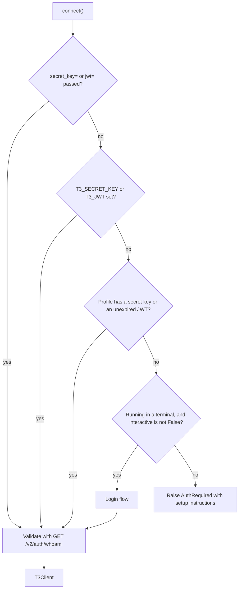

# t3api-utils 2.0 design

Draft, 2026-11-23. Spec figures are from the live T3 OpenAPI spec as of that date.

## 1. Summary

2.0 is a hard-break rewrite. It keeps the parts that make the library worth installing:

- secret-key auth and credential management
- loading whole collections
- server-side reports and tag lists
- the inspector

It drops the HTTP wrappers, the sync/async duplication and DuckDB. What the library knows about endpoints comes from the T3 OpenAPI spec at runtime, so new endpoints work without a library release.

**Goals**

- A script gets from `import` to data in three lines, with no prompts once a credential is saved.
- Secret keys are the default credential. The library pushes users to create one and manages them.
- New or changed endpoints in the T3 spec work without a new release.
- Behaves the same on Linux, macOS, Windows and in Jupyter.
- Never repeats a write that might have reached Metrc.

**Non-goals**

- A typed method per endpoint, or a generated client.
- Local analytics (DuckDB, relational tables, LLM schema export).
- An async API. It can be added later if someone needs it.
- Compatibility with 1.x. There are no shims; section 13 maps old names to new ones.

## 2. Decisions

| Area | Decision |
|---|---|
| Primary user | Scripts first (`uv run`). Prompts are opt-in: they appear only in a terminal, and only when arguments, env vars and the saved profile don't supply a credential. Every interactive helper has a non-interactive form. |
| HTTP | httpx2, Pydantic's maintained fork of httpx. Sync-only public API. |
| Concurrency | Parallel page fetching on a thread pool behind one shared rate limiter. No asyncio. |
| Endpoint naming | `x-t3-endpoint-id` (e.g. `METRC_ACTIVE_ITEMS`) or a path string, checked against the spec at runtime. |
| Spec changes | None required. Endpoint kinds are worked out from the spec's structure. |
| Spec source | A gzipped copy ships in the package. A live copy is fetched and cached so new endpoints appear without a release. |
| Auth | Secret keys first; credentials and JWT are a fallback. API-key auth (`/v2/auth/apikey`) is removed. |
| Credential storage | Named profiles in the user config folder; secrets in the OS keyring. No `.t3.env`. |
| If the user declines a secret key | Save only the JWT. When it expires, prompt again and offer a secret key again. The Metrc password is never stored. |
| Data | Plain dicts, exactly as the API returns them. |
| Writes | Dry run unless `submit=True`, matching the server. Routes with no dry run reject `submit`. |
| Reports and tag lists | The server endpoints become first-class features. A small local CSV filter and CSV/JSON export stay. |
| Interactive | A `t3api` CLI plus the Textual inspector (optional `[tui]` extra). The numbered menu is removed. |
| DuckDB and pyarrow | Removed entirely, because of Windows compatibility problems. |
| Package | Name stays `t3api-utils` (import `t3api_utils`). Python 3.12 or later. GPL-3.0-only. |
| Testing | 100% unit coverage with mocked HTTP, plus an opt-in smoke suite against the Metrc sandbox. CI on Linux, macOS and Windows. |
| 1.x | Frozen at 1.5.0. No further releases. |
| Repo | Tag `v1.5.0`, keep a `1.x` branch, and build 2.0 from scratch on a `v2` branch. |

## 3. Package layout

```
t3api_utils/
  __init__.py          connect(), T3Client, inspect(), filter_rows(), to_csv(), to_json(), pick_file(), errors
  client.py            T3Client: request(), get/post/put/patch/delete(), collect(), iter_rows(), bulk(), report()
  errors.py            exception hierarchy (section 7)
  _http.py             httpx2 client builder, retry transport, log redaction
  _ratelimit.py        thread-safe token bucket
  spec/
    loader.py          picks bundled vs cached vs live copy
    registry.py        Endpoint, Registry, classification, parameter checks
    openapi.json.gz    bundled spec (3.2 MB raw, about 250 KB gzipped)
  auth/
    credentials.py     httpx2.Auth classes: SecretKeyAuth, BearerAuth
    resolve.py         how connect() finds a credential
    login.py           interactive login flow and secret-key offer
    store.py           profiles (TOML) and keyring access
    secret_keys.py     list / create / rotate / delete
    states.py          GET /v2/states lookup (requiresOtp, requiresEmail)
  writes.py            submit handling, WriteResult, bulk helper
  tag_lists.py         TagLists namespace and TagList object
  local.py             filter_rows(), to_csv(), to_json()
  pickers.py           pick_license(), pick_endpoint(), pick_file() as Rich tables
  tui/inspector.py     Textual app, imported lazily
  cli/                 Typer app behind the `t3api` command
  _console.py          Rich console and purple theme (internal)
  py.typed
scripts/update_spec.py downloads the live spec into spec/openapi.json.gz before each release
```

Rules:

- Importing the package has no side effects: no files written, no logging configured, no network calls.
- Library code never calls `sys.exit()` or `typer.Exit`. Only `cli/` does.
- Modules whose names start with `_` are private.

## 4. Public API

```python
import t3api_utils as t3

client = t3.connect()                          # finds a credential (section 6)
client = t3.connect(profile="mi-prod")
client = t3.connect(secret_key="...", interactive=False)

client.whoami()                                # dict
client.licenses()                              # list[dict]
lic = client.pick_license()                    # interactive; returns the license number

# Collections: any of the 187 paginated endpoints
items = client.collect("METRC_ACTIVE_ITEMS", license=lic,
                       filter=["name__contains:flower"], sort="name:asc",
                       mask=["id", "name", "productCategoryName"])
for row in client.iter_rows("/v2/packages/active", license=lic):
    ...
item = client.get("METRC_ACTIVE_ITEMS", object_id=12345, license=lic)

# Writes: dry run unless submit=True
client.post("/v2/items/discontinue", license=lic, json={"id": 12345})
client.post("/v2/items/discontinue", license=lic, json={"id": 12345}, submit=True)
result = client.bulk("/v2/items/discontinue", rows=[{"id": i["id"]} for i in items], license=lic)

# Server-side reports and tag lists
client.report("ITEMS_REPORT", licenses=[lic], format="xlsx", to="items.xlsx")
tl = client.tag_lists.from_csv("labels.csv", column="label", license=lic,
                               endpoint="METRC_ACTIVE_PACKAGES", name="Room A")
packages = tl.resolve()

# Local helpers
subset = t3.filter_rows(items, match="input.csv", on_unmatched="warn")
t3.to_csv(subset, "subset.csv")
t3.inspect(subset)                             # needs t3api-utils[tui]

# Secret keys
client.secret_keys.list()

# Escape hatch: the configured httpx2.Client (auth, base URL, retries, logging)
client.http.get("/v2/anything-new", params={"licenseNumber": lic}).json()
```

`T3Client` is a context manager (`with t3.connect() as client:`) and closes its connection pool on exit.

| Member | What it does |
|---|---|
| `request(method, endpoint, *, license, params, json, files, submit, **path_params)` | Generic call. Looks up the endpoint ID or path in the spec, fills path parameters, checks parameters, and returns parsed JSON (or `bytes` for non-JSON responses). |
| `get` / `post` / `put` / `patch` / `delete` | Shorthands for `request`. Writes return a `WriteResult` (section 9). |
| `collect(endpoint, *, license, filter, filter_logic, sort, mask, page_size, progress)` | Every page, fetched in parallel, as one `list[dict]`. |
| `iter_rows(endpoint, ...)` | Same parameters; yields rows one page at a time for large collections. |
| `bulk(endpoint, rows, *, license, submit, confirm, on_error, log_to)` | Validate-then-submit for many writes (section 9). |
| `report(endpoint, *, licenses, format, to, columns, filter, sort, row_limit, delivery, email)` | Downloads a server report (section 10). |
| `tag_lists`, `secret_keys`, `spec` | Namespaces (sections 10, 6 and 5). |
| `whoami()`, `licenses()`, `states()` | Small helpers. |
| `pick_license()`, `pick_endpoint(kind=)` | Interactive pickers (section 11). |
| `http` | The underlying `httpx2.Client`. |

`license` can be left out when the profile has a default license. A license passed in code always wins. `collect` and `iter_rows` also accept a list of licenses and run one per license in turn. Every row already carries its `licenseNumber`.

## 5. Spec registry

### Where the spec comes from

The spec loads the first time something needs it, never at import. Raw `client.http` calls never need it.

1. **Cached live copy.** Stored under `platformdirs.user_cache_dir("t3api-utils")`, keyed by API host so sandbox or staging hosts get their own copy. Once it is an hour old, it's revalidated with `If-None-Match`. The spec endpoint sends a weak `ETag` and `Last-Modified`, so an unchanged spec costs one small 304 response.
2. **Live fetch** from `<base URL>/v2/spec/openapi.json`, with a 5 second timeout, saved to the cache.
3. **Stale cache**, if the fetch fails.
4. **Bundled copy**, `openapi.json.gz`.

Other ways to control it:

- `connect(spec="bundled")` or `T3_SPEC=bundled` pins the bundled copy, for reproducible runs.
- `t3api spec refresh` forces a fetch. `t3api spec info` shows which copy is in use and how old it is.
- `scripts/update_spec.py` refreshes the bundled copy as a release step.

### Classification

Each operation gets exactly one kind, from its structure alone. The rules are checked in this order:

| Kind | Rule | Count |
|---|---|---|
| collection | GET whose 200 JSON schema is an `allOf` containing `#/components/schemas/Pagination` | 187 |
| report | Response content includes `text/csv` or the XLSX type | 83 |
| metrc_write | Non-GET that takes the `Submit` parameter | 85 |
| immediate_write | Non-GET without `Submit` | 28 |
| file | GET returning `application/pdf` or `image/*` | 5 |
| object | GET with an `{object_id}` path parameter | 144 |
| other | Everything else (e.g. `/v2/licenses`, `/v2/auth/whoami`) | 124 |

That's 656 operations in total. The counts will change; the rules don't depend on them. 1.x's picker found 138 collections because it relied on a hardcoded list of ID parameters. The structural rule finds all 187.

### Lookup

- **One ID can name several operations.** For example, `METRC_ACTIVE_ITEMS` is both `/v2/items` and `/v2/items/{object_id}`. The method called picks between them: `collect` takes the collection, `get(..., object_id=...)` takes the object route, and `report` takes the report.
- **Paths:** any path in the spec works directly. Path parameters such as `{tag_list_id}` are passed as keyword arguments.
- **Unknown endpoints:** an ID or path that isn't in the spec raises `UnknownEndpoint`, listing close matches. Routes missing from the published spec can be reached only through `client.http`.
- **Discovery:** use `client.spec.find("harvest")`, `client.spec.endpoint("METRC_ACTIVE_ITEMS")` or `client.spec.list(kind="report")`. Each `Endpoint` has `id`, `method`, `path`, `kind`, `tags`, `summary` and `params`.

### Parameter checks

Before sending, `request` resolves the operation's parameters, following `$ref`s:

- A missing required parameter raises `SpecError` before any request is sent.
- An unknown query parameter logs a warning and is sent anyway. The cached spec can lag the server, and a hard error would block new parameters.
- The shared collection parameters map from Python names:

| Python | Query parameter |
|---|---|
| `license` | `licenseNumber` |
| `filter` (list) | one `filter=` per item |
| `filter_logic` | `filterLogic` |
| `sort` | `sort` |
| `mask` (list) | `collectionMask`, comma-joined |
| `page_size` | `pageSize` |

Later, not in 2.0.0: a `t3api stubs` command that writes TypedDicts for response schemas into the user's project, for editor completion.

## 6. Authentication

### Credentials

| Credential | Sent as | Lifetime | Role in 2.0 |
|---|---|---|---|
| Secret key | `X-T3-API-Key` header | Until deleted or disabled, or until the Metrc credentials behind it change | Default |
| JWT | `Authorization: Bearer` header | 24 hours | Fallback |

**Header only.** Secret keys go only in the header. The `?secretKey=` query form isn't supported, because it leaks into URLs and logs.

**How credentials are attached.** Each credential is an `httpx2.Auth` subclass attached to the client.

**401 messages.** On a 401 the client raises `AuthError` with a specific message:

- **Secret key:** it was revoked, or the Metrc credentials behind it changed (server code `METRC_LOGIN_FAILURE`). Run `t3api keys rotate`.
- **JWT:** it expired. Run `t3api login`.

### How connect() finds a credential



- **Which profile:** the `profile=` argument, then `T3_PROFILE`, then the config's default profile.
- **Validation** is one `whoami` call, on by default (`validate=False` skips it). A rejected credential raises `AuthError` and closes the client.
- **No hanging:** `connect()` never prompts when stdin isn't a terminal. Scheduled jobs fail fast with instructions instead of waiting for input.

### Login flow

The login flow runs from `t3api login`, or from `connect()` in a terminal when no credential is found.

1. **Existing key:** ask whether the user already has a secret key. If they paste one, validate it, save it, and stop.
2. **Metrc credentials:** ask for the Metrc hostname, username and password. `GET /v2/states` is public and reports whether that state `requiresEmail` or `requiresOtp`; ask for those only when needed.
3. **Secret-key offer** (default yes): "Create a secret key so you don't have to log in again?"
   - **Yes:** call `POST /v2/auth/secretkey` with the credentials. It needs no prior auth. In OTP states it needs the **OTP seed**, not a 6-digit code, because T3 signs in to Metrc on the user's behalf later. Save the key to the profile. The Metrc password is not stored.
   - **No:** call `POST /v2/auth/credentials`. OTP states take a 6-digit code, or a seed that pyotp turns into a code. Save only the JWT and its expiry. Tell the user it expires in 24 hours and that a secret key avoids this.
4. **Default license:** optionally pick one for the profile.

When a saved JWT has expired, `connect()` in a terminal restarts the flow at the offer in step 3.

The `/v2/states` result is cached alongside the spec. If it can't be reached, the client falls back to the 1.x lists: `mi.metrc.com` needs an OTP and `co.metrc.com` needs an email.

### Profiles and storage

Non-secret settings live in `platformdirs.user_config_dir("t3api-utils")/config.toml`:

```toml
default_profile = "mo"

[profiles.mo]
api_host = "https://api.trackandtrace.tools"
metrc_hostname = "mo.metrc.com"
username = "jdoe"
license = "LIC-00001"        # optional default
credential = "secret_key"    # or "jwt"
```

- **Where secrets go:** the OS keyring, under service `t3api-utils` with entry `<profile>:secret_key` or `<profile>:jwt`. That means macOS Keychain, Windows Credential Manager, or Secret Service on Linux.
- **No keyring available** (headless Linux, containers), or a keyring write fails: the secret goes in `secrets.toml` next to the config, readable only by the user, with a printed warning.
- **CI:** use `T3_SECRET_KEY` instead.
- **Environment variables** in 2.0: `T3_SECRET_KEY`, `T3_JWT`, `T3_PROFILE`, `T3_LICENSE`, `T3_API_HOST`, `T3_SPEC`, `T3_LOG_HTTP`, `T3_LOG_FILE`.

### Secret key management

A secret key's ID is the key value itself, so rotate and delete take the key.

| Python (`client.secret_keys`) | CLI | Endpoint |
|---|---|---|
| `list()` | `t3api keys list` (keys shown masked) | `GET /v2/auth/secretkey` |
| `create(hostname, username, password, email=None, otp_seed=None)` | `t3api keys create` | `POST /v2/auth/secretkey` |
| `rotate(key, password=..., email=None, otp_seed=None)` | `t3api keys rotate` | `PUT /v2/auth/secretkey/{key}`. The key value doesn't change; use it after a Metrc password, email or OTP seed change. |
| `delete(key)` | `t3api keys revoke` | `DELETE /v2/auth/secretkey/{key}`. Managed keys can't be deleted. |

Related commands:

- `t3api logout` removes the profile's saved secret. Adding `--everywhere` also calls `POST /v2/auth/logout`, which logs out all Metrc sessions.
- `connect(sandbox=True)` swaps the credential for a sandbox JWT via `POST /v2/auth/sandbox`.

## 7. HTTP layer, errors, logging

### Client

- Each `T3Client` owns one `httpx2.Client`.
- **Base URL:** from the profile, then `T3_API_HOST`, then `https://api.trackandtrace.tools`.
- **Timeout:** 30 seconds; report downloads get 5 minutes.
- **User-Agent:** `t3api-utils/<version>`.
- **Threads:** the client is shared across the paging threads.

### Retries

Retries live in a small custom transport.

| Method | Retried on | Never retried |
|---|---|---|
| GET, HEAD, OPTIONS | Connection errors, 429, 502, 503, 504 | Other 4xx and 5xx |
| POST, PUT, PATCH, DELETE | 429, and connection failures before the request was sent | 5xx, timeouts after sending, every other 4xx |

- **Attempts:** at most 3, with exponential backoff and jitter (about 0.5s, then 1s). A `Retry-After` header is honored.
- **Why writes are different:** a 429 means the server rejected the request, so retrying a write is safe. A 5xx or a read timeout may mean the write reached Metrc, so writes never retry on those.
- **The 1.x bug this fixes:** 1.x sent a POST that got a 400 three times.

### Rate limiting

- One thread-safe token bucket per client (a lock plus a monotonic clock), shared by every request that client makes.
- **Defaults:** 10 requests per second and 10 paging workers, carried over from 1.x. Change them with `connect(rate_limit=..., concurrency=...)`.
- **The 1.x bug this fixes:** 1.x's limiter let 20 requests through in 0.2 seconds.

### Errors

```
T3Error
├── AuthRequired         no credential found, and no terminal to ask in
├── NotInteractive       a picker or prompt called without a terminal
├── SpecError            missing required parameter, wrong endpoint kind
│   └── UnknownEndpoint  ID or path not in the spec
└── APIError             any non-2xx: .status_code .response .method .url .detail .errors
    ├── AuthError        401, 403
    ├── NotFound         404
    ├── ValidationError  400, 422
    │   └── TagListResolveError
    ├── RateLimited      429 after retries
    └── ServerError      5xx
```

- Every `APIError` keeps its response. 1.x dropped it, so `status_code` was always `None`.
- `detail` and `errors` come from `application/problem+json` bodies when present. Otherwise the error uses the body text, truncated.

### Logging

- **Where the library logs:** to `logging.getLogger("t3api_utils")`. It never configures handlers or the root logger.
- **HTTP debug logging:** `T3_LOG_HTTP=1`, or `connect(log_http=True)`, logs each request and response at DEBUG, including headers and bodies. `T3_LOG_FILE` writes it to a file.
- **What's hidden in those logs:**
  - `Authorization`, `X-T3-API-Key` and cookie headers.
  - The key in `/v2/auth/secretkey/{key}` paths.
  - `password`, `otp` and `otpSeed` fields in JSON bodies.

  1.x logged credential-login bodies, password included, whenever HTTP logging was on.
- **The CLI** sets up Rich logging for itself.

## 8. Collections

`collect()`:

1. Resolve the endpoint to its collection operation. Anything else raises `SpecError`.
2. Fetch page 1 with `page_size` (default 100, the spec's default).
3. Read `totalPages` from the response's `Pagination` fields. Fetch the remaining pages on the thread pool, through the rate limiter.
4. Return the rows in page order. When stderr is a terminal, show a Rich progress bar (`progress=False` hides it).

Details:

- **Shifting data:** pages are read at slightly different times, so rows can move between pages if data changes mid-load. `collect` drops rows whose `id` it has already seen and logs how many. Rows that moved into an already-read page can't be recovered; that limitation is documented.
- **Failures:** a page that still fails after retries fails the whole `collect`, and the error names the page. Partial results are never returned silently.
- **Large collections:** `iter_rows` fetches one page at a time, for jobs that can't hold everything in memory.
- **Multi-license:** `license=["A", "B"]` runs one load per license, in turn, and joins the results.

## 9. Writes

The route's kind in the spec decides how a write behaves.

| Route kind | `submit` left out | `submit=True` |
|---|---|---|
| metrc_write (85 routes) | Dry run. The server validates and nothing reaches Metrc. Returns `dry_run=True`. | Sent to Metrc. |
| immediate_write (28 routes: auth, tag lists, label layouts, saved reports, support tickets) | Takes effect immediately. | Raises `ValueError`: the route has no dry run. |

- **Return value:** write methods return `WriteResult(dry_run, message, data, response)`. The server's `message` is `"Dry run"` or `"Success"`.
- **Dry-run notice:** a dry run logs at INFO, "dry run: pass submit=True to send to Metrc".
- **License:** `license` fills the `licenseNumber` query parameter.

### Bulk helper

`client.bulk(endpoint, rows, *, license, submit=False, confirm=False, on_error="stop", log_to=None)` generalizes `scripts/discontinue-items.py`:

1. **Validate** (metrc_write routes only): send every row as a dry run and record each result.
2. **If any row failed:** stop and return the results.
   - In a terminal, show the failures and ask whether to submit only the valid rows.
   - Non-interactive callers pass `on_error="skip"` to do that without asking.
3. **Submit**, only when `submit=True`: send each valid row with `submit=true`, one at a time, in order.
4. **Return** a `BulkResult` with each row's status, message and response data. `log_to="results.csv"` also writes it to a file.

Notes:

- **Immediate routes** have no validation pass, so `bulk` requires `confirm=True` there and says why.
- **Batching:** 2.0.0 sends one request per row. Many create endpoints accept an array of rows; batching them is a later option.

## 10. Reports, tag lists, local data

### Reports

`client.report()` calls any report endpoint. There are 83 today; `client.spec.list(kind="report")` lists them.

```python
client.report("ITEMS_REPORT", licenses=["LIC-1", "LIC-2"], format="xlsx",
              to="items.xlsx", columns=["name", "productCategoryName"],
              filter=["name__contains:flower"], sort="name:asc")
```

- **`format`** maps to `contentType`: `json`, `csv`, `xlsx` or `googleSheets`.
- **`licenses`** maps to the multi-valued `licenseNumber`. The spec allows up to 20 per call; more raises `ValueError`.
- **`to=`** streams the download to a file and returns its path. Without it, `report` returns `bytes`, or parsed JSON for `format="json"`.
- **Email delivery:** `delivery="email"` with `email=` asks the server to email the report instead.
- **Saved reports and schedules** (`/v2/saved-reports`) are reachable through `client.request`. There's no dedicated helper in 2.0.0.

### Tag lists

`client.tag_lists` wraps `/v2/tag-lists`:

| Method | Endpoint |
|---|---|
| `list()`, `get(id)` | `GET /v2/tag-lists`, `GET /v2/tag-lists/{id}` |
| `create(name, license, endpoint=None, visibility="USER", handles=None)` | `POST /v2/tag-lists` |
| `from_csv(path, column, ...)`, `from_rows(rows, field, ...)` | create, then add |
| `add(id, handles_or_entries)`, `remove(id, handles)` | `POST` / `DELETE /v2/tag-lists/{id}/entries`, split into chunks of 5,000 |
| `entries(id)` | `GET /v2/tag-lists/{id}/entries` |
| `scan(id, handles)` | `POST /v2/tag-lists/{id}/scan` |
| `resolve(id, endpoint=None)` | `GET /v2/tag-lists/{id}/resolve`, paged like a collection |

`create`, `get` and `from_*` return a `TagList` with the same methods bound to its ID, so `tl.resolve()` works.

How resolve behaves:

- **All or nothing:** if any handle matches zero objects or several, the server returns 422. The helper raises `TagListResolveError`, carrying the server's per-handle `errors`, so a script can fix its CSV.
- **Matching:** the server matches on one field per collection: `label` for packages, plants and tags; `name` for items, harvests, plant batches and strains; `manifestNumber` for transfers. The client doesn't hardcode any of this.
- **COA extraction** (`.../coa-extraction`) is reachable through `client.request`. A dedicated helper can come later.

### Local filter

For matching that tag lists can't do, use `t3.filter_rows(rows, match, *, columns=None, on_unmatched="warn")`:

- **`match`** is a CSV or TSV path, or a list of dicts.
- **Columns** default to the CSV header. Every column must exist in the rows; dotted paths such as `item.name` are allowed.
- **Comparison:** values compare as stripped strings. A dict index is built first, so the cost is rows plus matches. 1.x compared every row against every match.
- **`on_unmatched`:** `"warn"`, `"error"` or `"skip"`.
- **No file picker inside:** for an interactive script, call `t3.pick_file()` first and pass the result.

### Export

`t3.to_csv(rows, path=None, *, columns=None, strip_empty=False)` and `t3.to_json(rows, path=None, *, lines=False)`:

- **Flattening:** nested objects become dotted columns (`item.name`). Lists are written as JSON text, not Python reprs as in 1.x.
- **Column order:** 1.x's priority fields come first (`hostname`, `licenseNumber`, `retrievedAt`, `dataModel`, `index`, `id`, `label`, `name`), then the rest alphabetically.
- **Encoding:** CSV is written as UTF-8 with a BOM so Excel on Windows opens it correctly.
- **Default name:** `path=None` writes `<dataModel>__<license>__<timestamp>.<ext>` in the current folder.

## 11. CLI and interactive tools

The `t3api` command (Typer):

| Command | What it does |
|---|---|
| `t3api login [--profile P] [--host URL]` | Login flow (section 6) |
| `t3api logout [--profile P] [--everywhere]` | Remove the saved credential; optionally log out all Metrc sessions |
| `t3api whoami` | Current user, profile and credential type |
| `t3api profiles list` / `use P` / `remove P` | Manage profiles |
| `t3api license` / `license pick` / `license set LIC` | Show or set the profile's default license |
| `t3api keys list` / `create` / `rotate` / `revoke` | Secret key management |
| `t3api endpoints [QUERY] [--kind K]` | Search the spec |
| `t3api pull ENDPOINT [-l LIC]... [--filter F]... [--sort S] [--mask M] [-o FILE] [--inspect]` | Load a collection to CSV or JSON (chosen by file extension), or open it in the inspector |
| `t3api report ENDPOINT [-l LIC]... [--format F] [-o FILE]` | Download a server report |
| `t3api tag-lists list` / `create FILE --column C` / `resolve ID [-o FILE]` | Common tag-list tasks |
| `t3api inspect FILE` | Open a JSON or CSV file in the inspector |
| `t3api spec info` / `spec refresh` | Show the spec copy in use, or force a refresh |

Interactive helpers for scripts:

- **Pickers:** `client.pick_license()`, `client.pick_endpoint(kind=...)` and `t3.pick_file()` show Rich tables that follow the picker standards in CLAUDE.md.
- **Without a terminal** they raise `NotInteractive`. Ctrl-C raises `KeyboardInterrupt` to the caller instead of exiting.
- **The Textual inspector** is ported from 1.x as `t3.inspect(rows)`. It imports Textual only when called. Without `t3api-utils[tui]` installed, it raises an `ImportError` that names the install command.
- **The tutorial:** the 650-line `intro.py` becomes a "Getting started" docs page.

## 12. Packaging, testing, CI

### Packaging

- **`pyproject.toml`:**
  - name `t3api-utils`, version `2.0.0`
  - `requires-python = ">=3.12"`, license `GPL-3.0-only`
  - build backend `uv_build`
  - `[project.scripts] t3api = "t3api_utils.cli:app"`
- **Core dependencies:** `httpx2`, `rich`, `typer`, `keyring`, `platformdirs`, `pyotp`, `tomli-w`. TOML is read with the standard library's `tomllib`.
- **Extra `tui`:** `textual`.
- **Removed:** `duckdb`, `pyarrow`, `questionary` (unused in 1.x) and `python-dotenv`.
- **Dev group:** `pytest`, `pytest-cov`, `mypy`, `mkdocs`, `mkdocs-material`, `mkdocstrings[python]`.

### Testing

- **Unit tests** mock HTTP with `httpx2.MockTransport`. Coverage must stay at 100% (`--cov-fail-under=100`).
- **Spec tests** run against the bundled spec and check the kind of specific named endpoints, not the counts, which change.
- **Retry tests** check that a POST answered with 400 or 500 is sent exactly once.
- **Keyring tests** use an in-memory keyring backend.
- **Sandbox smoke suite** (`pytest -m sandbox`), skipped unless `T3_SMOKE_SECRET_KEY` is set:
  - The key is exchanged for a sandbox JWT through `POST /v2/auth/sandbox`, so writes hit the Metrc sandbox.
  - It covers `whoami`, a small `collect`, a dry-run write, a report download and a tag-list create/resolve.
  - Run it before each release.
- **mypy** runs in strict mode on `t3api_utils` and the tests.

### CI

GitHub Actions runs `uv sync`, then mypy and pytest. The matrix is Ubuntu, macOS and Windows, on Python 3.12 and 3.13.

## 13. What goes away

| 1.x | 2.0 |
|---|---|
| `get_authenticated_client_or_error()` and about 22 other auth functions | `t3.connect()` |
| `*_with_validation` variants | `connect(validate=True)`, the default |
| API-key auth, `API_KEY`, `API_STATE_CODE` | Removed |
| `?secretKey=` query transport | Removed; header only |
| `.t3.env`, `ConfigManager`, 37 `EnvKeys` | Profiles and keyring, plus 8 env vars (section 6) |
| `T3APIClient` (async) and its sync wrappers | `T3Client` (sync) |
| `send_api_request[_async]`, 8 `request_*` helpers | `client.request()`, `client.http` |
| `get_collection[_async]`, `load_all_data_*`, `parallel_load_*`, `load_collection` | `client.collect()`, `client.iter_rows()` |
| `RateLimiter` | Internal token bucket |
| `pick_collection`, `get_collection_endpoints` | `client.pick_endpoint()`, `client.spec`, `t3api endpoints` |
| `pick_license`, `pick_file` | `client.pick_license()`, `t3.pick_file()` |
| `interactive_collection_handler`, `main/handlers.py` | `t3api pull`, `t3.inspect()` |
| `inspect_collection` | `t3.inspect()` (needs `[tui]`) |
| `match_collection_from_csv` | `client.tag_lists`, `t3.filter_rows()` |
| `save_collection_to_*`, `save_dicts_to_*` | `t3.to_csv()`, `t3.to_json()` |
| `db/` (DuckDB tables, schema export) | Removed |
| `style/`, `logging.setup_logging()` | Internal, or gone |
| `intro.py` | Docs page |
| `MetrcObject`, `MetrcCollectionResponse` and other TypedDicts | Plain dicts |

The docs get a migration page with this table, plus before/after versions of `scripts/example.py` and `scripts/discontinue-items.py`.

## 14. Implementation plan

Each milestone lands as its own PR on `v2`, with coverage at 100%.

| # | Milestone | Contents | Needs |
|---|---|---|---|
| M0 | Setup | Tag `v1.5.0`; create `1.x` and `v2` branches; empty package; `uv_build`; CI matrix | |
| M1 | Core client | `errors`, `_http` (httpx2, retry transport, redaction), Auth classes, `T3Client.request` and `http`, `connect(secret_key=..., jwt=...)` and env vars | M0 |
| M2 | Spec | Bundled spec, loader and cache, registry, classification, parameter checks, `update_spec.py` | M1 |
| M3 | Collections | `collect`, `iter_rows`, rate limiter, progress bar, multi-license | M2 |
| M4 | Auth | Profiles and keyring, `/v2/states`, login flow, secret-key offer, `secret_keys`, `whoami`, `logout`, sandbox | M1 |
| M5 | Writes | `WriteResult`, submit rules, `bulk` | M2 |
| M6 | Reports, tag lists, local tools | `report`, `tag_lists`, `filter_rows`, `to_csv`, `to_json` | M3, M5 |
| M7 | CLI and interactive | Typer app, pickers, inspector port | M4, M6 |
| M8 | Docs and release | mkdocs rewrite, getting-started and migration pages, sandbox suite, `2.0.0b1`, then `2.0.0` | M7 |

After M1, M2 and M4 can proceed in parallel.

## 15. Open questions and assumptions

- **Server rate limits and maximum page size.** The spec gives `pageSize` a default of 100 and no maximum. The defaults here (10 requests per second, 10 workers, 100 per page) stand until T3's real limits are known. A larger page size would cut request counts a lot.
- **Write routes missing from the published spec.** A server audit counted 128 v2 write routes; the published spec lists 113. Assumption: the unpublished ones are internal, and reachable only through `client.http`.
- **JWT size on Windows.** Windows Credential Manager caps a stored secret at 2,560 bytes. If T3 JWTs come close, JWTs fall back to the secrets file on Windows. This needs a real JWT's length to settle. Secret keys are 36-character UUIDs, so they're unaffected.
- **OTP and email detection.** This refines an earlier decision to keep hardcoded hostname lists. The client reads `requiresOtp` and `requiresEmail` from `GET /v2/states`, an existing public endpoint (not a spec change), and falls back to the 1.x lists offline.
- **Deduplicating rows that shift between pages.** Assumption: `id` is unique within one collection and license.
